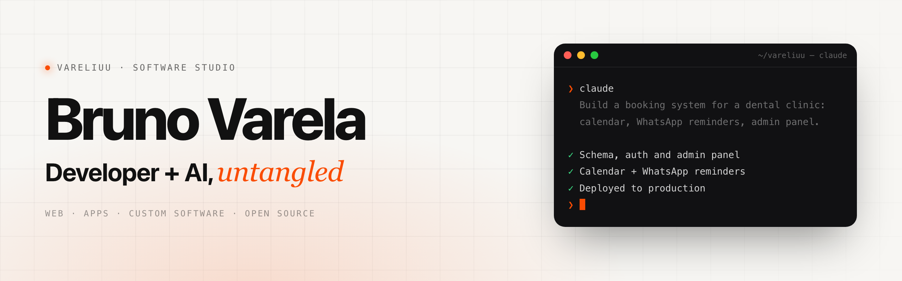
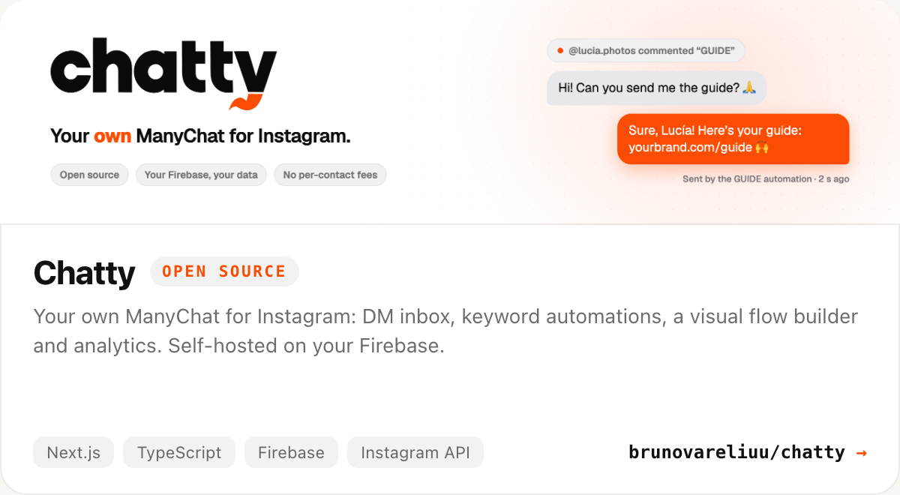
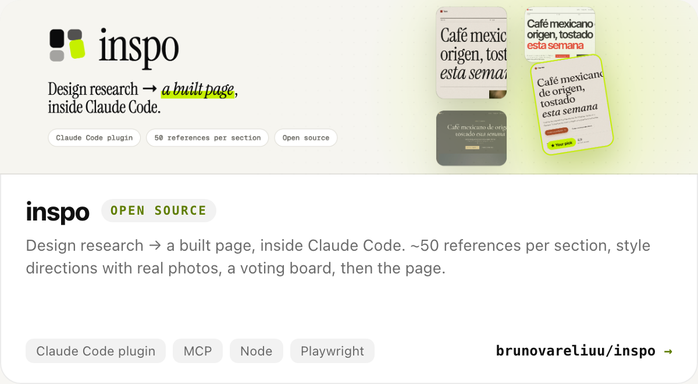

<picture>
  <source media="(prefers-color-scheme: dark)" srcset="assets/hero-oscuro.png">
  
</picture>

  
  
  

I'm Bruno. I founded **[Vareliuu](https://vareliuu.com)**, a custom software studio from Mexico: websites,
apps and internal systems for businesses, from idea to production in weeks. I build with Claude every
day, and on Instagram I share **AI, untangled** (in Spanish): how I actually build, without the hype.

### Open source

  <a href="https://github.com/brunovareliuu/chatty"><picture>
    <source media="(prefers-color-scheme: dark)" srcset="assets/chatty-oscuro.png">
    
  </picture></a>
  <a href="https://github.com/brunovareliuu/inspo"><picture>
    <source media="(prefers-color-scheme: dark)" srcset="assets/inspo-oscuro.png">
    
  </picture></a>

### Now

- Building custom software for businesses at **Vareliuu**: booking systems, admin panels, stores, apps.
- Open-sourcing the tools I use every day: **[Chatty](https://github.com/brunovareliuu/chatty)** and **[inspo](https://github.com/brunovareliuu/inspo)**.
- Showing how I build with AI, step by step, on **[Instagram](https://www.instagram.com/brunovareliuu)**.

### Stack

  
  
  
  
  
  
  
  
  
  
  

---

  <b>Have a problem software could solve?</b> <a href="https://vareliuu.com">Tell me about it at vareliuu.com</a> ↗

